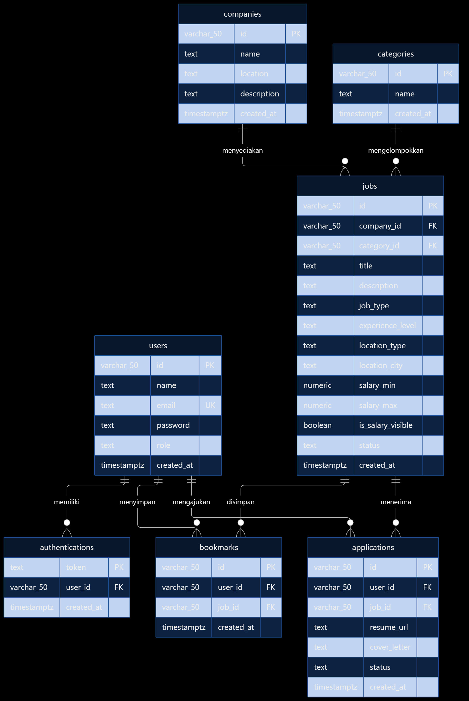

# OpenJob API

REST API untuk mengelola lowongan kerja, lamaran, dan bookmark.
Dibangun sebagai proyek backend Dicoding menggunakan Node.js, Express,
dan PostgreSQL.

## Fitur

- Registrasi dan autentikasi JWT, termasuk refresh token dan logout
- Pengelolaan perusahaan, kategori, dan lowongan kerja
- Pengajuan lamaran, perubahan status lamaran, dan bookmark lowongan
- Validasi request dengan Joi dan migrasi database dengan node-pg-migrate

## Menjalankan secara lokal

Buat database PostgreSQL `openjob`. Salin `.env.example` menjadi `.env`,
lalu isi konfigurasi database dan kunci JWT. Jalankan dari folder proyek:

```bash
npm ci
npm run migrate -- up --envPath .env
npm start
```

Dengan konfigurasi contoh, API tersedia di `http://localhost:3000`.

## Pengujian

**296 dari 296 pemeriksaan lulus** pada pengujian lokal menggunakan
collection OpenJob API Test V1 di Postman.

## Diagram database


